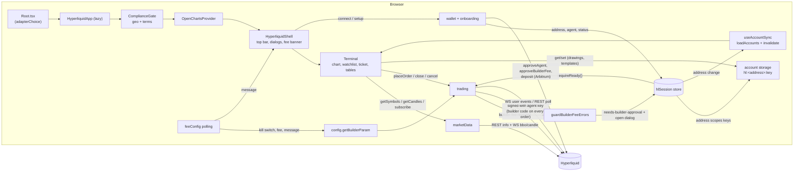

# Architecture

OpenCharts is a terminal (charts, panels, order flow) that talks to a backend through one contract, the
`OpenChartsAdapter` in `src/adapter/types.ts`. The Hyperliquid broker is an adapter plus a small amount of UI
that appears only when that adapter is installed. Nothing in the terminal imports Hyperliquid code
statically, so the default demo bundle does not carry it.

## Module map

| Area | Files | Responsibility |
|---|---|---|
| Contract | `src/adapter/{types,registry,provider}.ts(x)` | The adapter interface, the module-level registry, and `<OpenChartsProvider>` (query cache, stream bridge, boot) |
| Terminal | `src/terminal/*`, `src/pages/trading/*` | Shared state (`TerminalProvider`), the default layout, and the panels |
| App root | `src/Root.tsx`, `src/adapterChoice.ts` | Picks demo, Binance or Hyperliquid from env; loads the last two lazily |
| Config and session | `hyperliquid/{config,session,types}.ts` | Network, builder code and fee clamp; the zustand session (address, agent key, status); shared types |
| Market data | `hyperliquid/{info,ws,symbols,marketData}.ts` | REST client with retry and cache, one WebSocket, market registry (core and HIP-3), the `MarketDataSource` |
| Trading | `hyperliquid/{exchange,orders,accountState,trading}.ts` | Order planning and signing, account reads and mappers, the `TradingGateway` with leverage controls |
| Wallet | `hyperliquid/wallet/*` | EIP-6963 discovery, connect and restore, agent-key approval, builder-fee approval, deposits and withdrawals |
| Onboarding UI | `hyperliquid/onboarding/*` | `ConnectButton`, `SetupDialog`, `DepositPanel`, `AccountBadge` |
| Fees | `hyperliquid/{fees,feeConfig}.ts` | Fee maths and disclosure text; the remote fee config and kill switch |
| Compliance | `hyperliquid/compliance/*` | `ComplianceGate` (geo, terms), `MarketRiskBadge` |
| Terminal UI | `hyperliquid/ui/*` | Shell, top bar, order ticket, watchlist, depth panel, market-hours note, pure models |
| Composition | `hyperliquid/adapter.ts` | `createHyperliquidAdapter()`: market data + trading + account-scoped storage |

## How the Hyperliquid UI plugs in

Shared panels call `isHyperliquidMode()` (`hyperliquid/ui/mode.ts`), which only checks the installed adapter's
name. When true they render the Hyperliquid variant, loaded with `React.lazy`:

- `OrderPanel` renders `HlOrderPanel`
- `WatchlistPanel` renders `HlWatchlist`
- `DOMPanel` renders `HlDepthPanel` (real `l2Book`, not the simulated ladder)
- `MarketClosedBanner` renders `HlMarketNotice`

`mode.ts` imports only the adapter registry and types, so referencing it from shared code costs almost nothing.
The Hyperliquid variants reach the adapter's extras (leverage controls, market registry, info client) through
the typed accessors `getHlTrading()`, `getHlRegistry()` and `getHlInfo()`.

## Data flow

### Order lifecycle

1. The ticket validates size (precision, $10 minimum unless reduce-only) and builds the order with leverage and
   margin mode.
2. Unless one-click applies, the confirmation dialog shows notional, margin, fee estimate for this order and for a
   round trip, and an isolated-margin liquidation estimate.
3. On confirm the ticket first makes the exchange's leverage match the ticket (`setLeverage`), then calls
   `placeOrder`. The gateway signs with the agent key and attaches the builder code.
4. If Hyperliquid rejects the builder fee (it was raised remotely beyond what the user approved),
   `guardBuilderFeeErrors` moves the session to `needs-builder-approval` and opens the "fee settings changed"
   dialog. This works for every order path, not just the ticket.
5. Fills and position changes arrive over the user WebSocket (or a REST poll when it cannot connect) and flow
   into the same stores the demo uses.

### Where state lives

| State | Where | Scope |
|---|---|---|
| Wallet address, agent key, status | `hlSession` (zustand) | Tab |
| Dialog intents (setup, deposit) | `useHlUi` (zustand) | Tab |
| Drawings, chart templates, journal | `StorageDriver` from the adapter, keys `hl:<address or anon>:<key>` | Follows the account |
| Favourites, panel sizes, sound | `safe-storage` directly | Device |
| Terms acceptance | compliance module | Device |

## Notes and limits

- The account id is the wallet address. `useAccountSync` reloads accounts when it changes and clears them on
  disconnect. Storage keys are resolved on every call, but a mounted chart keeps what it already loaded until
  it next reads, so switching wallets mid-session is best finished with a reload.
- Platform-fee amounts shown in the ticket are estimates from the configured rate and Hyperliquid's base tier;
  the user's actual tier and HIP-3 fee scale can differ.
- The market-hours note is a hint with fixed UTC windows and no holiday calendar; see `ui/marketHours.ts`.

## Review log (trading / orders / exchange / accountState)

- Leverage is never changed on a guess: failed position or `activeAssetData` reads skip the default; an isolated setting is never flipped to cross; explicit leverage under a position applies within the same margin mode and refuses a mode switch.
- `builderField` lowercases/validates the builder address and floors/caps `f` at 100 for every order-creating path.
- `closeAllPositions` reads every dex strictly (a flaky HIP-3 dex fails the call instead of leaving positions open); close actions are de-duplicated while in flight.
- `cancelAllOrders` tolerates already-gone orders per chunk. Recovered fills no longer report the slippage bound as the average price.
- Live sync: REST snapshots are ordered against websocket pushes (stale ones dropped); a dex missing for one tick no longer emits `position.closed`.
- Unified accounts (verified live via `userAbstraction`): equity/free margin come from spot USDC + unrealised PnL and `tokenToAvailableAfterMaintenance`, not the near-empty perp slice. PortfolioMargin is not modelled.
- `TradeError.code === "builder-fee-unapproved"` is set from the raw HL text before humanising; use `isBuilderFeeUnapprovedError`.
- Known limitation: the SDK `modify` action has no `builder` field, so modified orders carry no builder fee.
